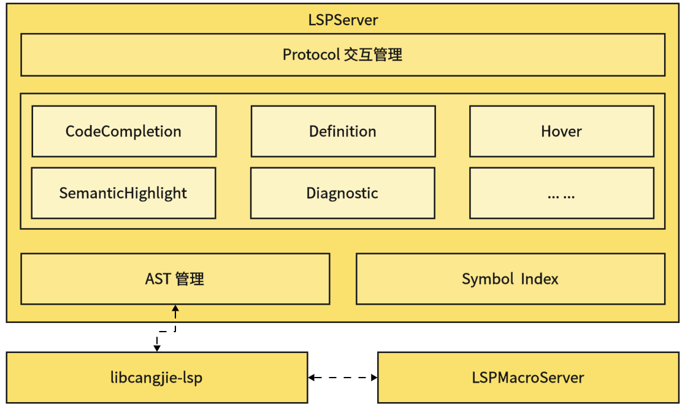

# 仓颉语言服务器开发者指南

## 开源项目介绍

该项目是一个语言服务器，支持仓颉的IDE功能。

这个工程可以编译成一个名为LSPServer的可执行文件。

系统架构图如下：



## 目录结构

```text
cangjie-language-server/
|- build          # 语言服务源码构建脚本存放文件夹
|- doc            # 语言服务开发指南和用户指南存放文件夹
|- generate       # 语言服务自定义索引结构文件存放文件夹
|  |- index.fbs   # 语言服务自定义索引结构文件
└─ src            # 语言服务源码文件夹
...
```

## 编译构建

### 构建准备

语言服务构建依赖cjc，所以在构建这个工程之前，我们应该先完成前置构建，构建方式参见[仓颉SDK集成构建指导书](https://gitcode.com/Cangjie/cangjie_build/blob/develop/README_zh.md)。更多软件依赖，参见[环境准备](https://gitcode.com/Cangjie/cangjie_build/blob/develop/docs/env_zh.md)。

### 构建步骤

我们可以使用build.py来编译项目，命令如下:

```shell
python build.py build --cangjie-sdk-path /path/to/cangjie-sdk -t Release -j 16  # (for Linux/MacOS)
# '--cangjie-sdk-path' option specifies a precompiled Cangjie sdk path
python build.py build --cangjie-sdk-path /path/to/cangjie-sdk -t Release -j 16 --cross-windows  # (for Linux-to-Windows)
```

构建完成后，将在`output/bin`下生成`LSPServer`二进制。

使用以下命令清理项目：

```shell
python build.py clean
```

### 更多构建选项

`python build.py build` 命令也支持其它参数设置，具体可通过如下命令来查询：

```shell
python build.py build -h
```

## 仓颉 SDK 集成构建

仓颉SDK集成构建，参见[仓颉SDK集成构建指导书](https://gitcode.com/Cangjie/cangjie_build/blob/develop/README_zh.md)。

## 相关仓

本仓为仓颉工具源码，本文档介绍的是仓颉语言服务工具，完整组件相关仓如下：

- [仓颉语言开发指南](https://gitcode.com/Cangjie/cangjie-docs/tree/release-cangjie-merged/docs/dev-guide)：提供仓颉语言开发指南；
- [仓颉编译器](https://gitcode.com/Cangjie/cangjie-compiler/tree/release-cangjie-merged)：提供仓颉编译器源码；
- [仓颉标准库](https://gitcode.com/Cangjie/cangjie-runtime/tree/release-cangjie-merged/std)：提供仓颉标准库源码；
- [仓颉运行时](https://gitcode.com/Cangjie/cangjie-runtime/tree/release-cangjie-merged/runtime)：提供仓颉运行时源码；
- [**仓颉工具**](https://gitcode.com/Cangjie/cangjie-tools/tree/release-cangjie-merged)：提供仓颉工具套源码。
